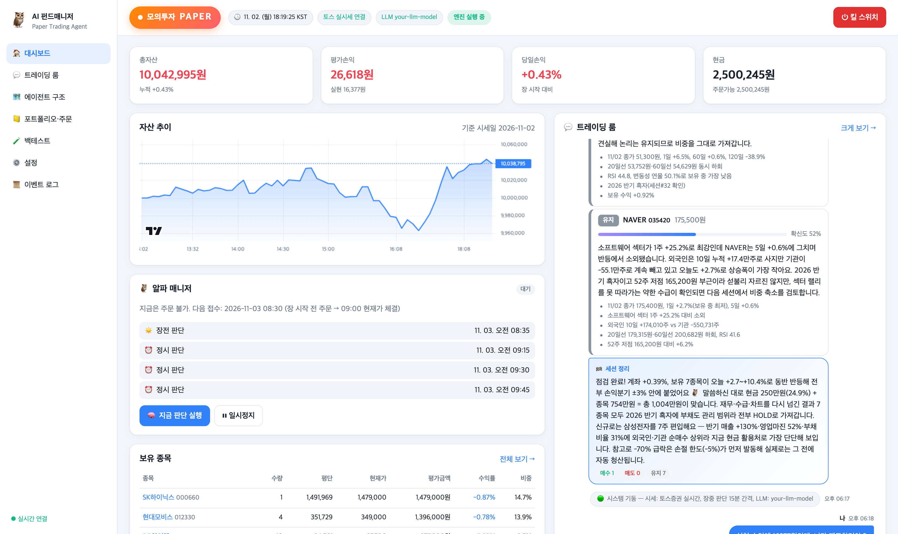
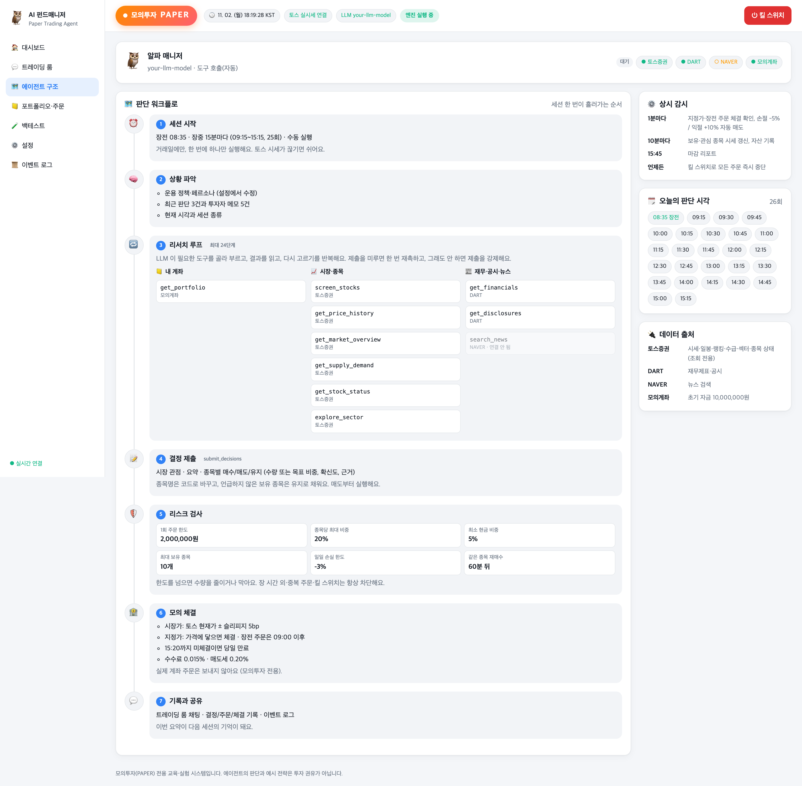

# 🦉 AI 펀드매니저 — 자율 주식 운용 에이전트



LLM 매니저가 국내 주식을 직접 조사하고 **매수·매도·유지**를 판단합니다. 보유 종목도 세션마다 다시 평가합니다.

- **시세·수급·지수·섹터**: 토스증권 Open API (실제 KOSPI·KOSDAQ 종목)
- **재무제표·공시**: OpenDART
- **뉴스**: 네이버 검색 API
- **주문·체결**: 모의투자는 자체 가상 계좌(PaperBroker)가 토스 실시간 현재가로 체결, 실거래는 토스증권 실계좌로 실제 주문
- **진행 과정**: 웹 UI의 **트레이딩 룸**에서 채팅처럼 실시간 중계

> ⚠️ **면책**: 에이전트의 판단, 예시 전략(이동평균 크로스·RSI), 백테스트 결과는 **투자 권유가 아니며** 수익을 보장하지 않습니다. 실거래 모드를 켜면 실제 돈으로 주문이 나가고, 손실을 포함한 모든 결과는 사용자 책임입니다.

| 모드 | 상태 |
|---|---|
| **모의투자 (paper)** | ✅ 기본값 — 실제 시세 + 가상 계좌 |
| **실제 투자 (live)** | ✅ 선택 — 토스증권 실계좌로 실제 주문. `.env` 에서 직접 켜야 함 ([1-3](#1-3-실제-투자-live) 참고) |

---

## 1. 환경 세팅

### 1-1. 공통 준비물

둘 중 하나만 있으면 됩니다.

| 실행 방식 | 필요한 것 |
|---|---|
| **Docker (권장)** | Docker Desktop (backend + frontend + PostgreSQL 을 한 번에 띄움) |
| **로컬** | Python 3.12 · [uv](https://docs.astral.sh/uv/) · Node.js 22 (DB 는 SQLite) |

```bash
git clone https://github.com/CodeofO/autonomous-trading-agent.git
cd autonomous-trading-agent
cp .env.example .env
```

`.env` 는 `.gitignore` 에 등록돼 있어 git 에 올라가지 않습니다. 키 값은 **`.env` 에만** 넣고, 코드·이슈·채팅에 붙여 넣지 마세요. 로그에는 `abcd****` 형태로만 남습니다.

### 1-2. 모의투자 (paper)

증권사 모의투자 신청은 **필요 없습니다.** 주문·체결·잔고는 이 프로젝트 안의 가상 계좌가 처리합니다.

`.env` 에 아래 값을 채웁니다 (키 이름만 표시, 값은 직접 입력).

| 키 | 필수 | 용도 | 발급처 |
|---|---|---|---|
| `TRADING_MODE` | 고정 | 반드시 `paper` (다른 값이면 기동 거부) | — |
| `TOSS_CLIENT_ID` · `TOSS_CLIENT_SECRET` | **필수** | 실시간 현재가·일봉·종목·랭킹·수급·장 운영 캘린더 (**조회만**) | 토스증권 WTS → 설정 > Open API (토스증권 계좌 필요) |
| `LLM_BASE_URL` · `LLM_MODEL` · `LLM_API_KEY` | 권장 | 매니저의 두뇌 (OpenAI 호환 Chat Completions, `api.openai.com` 이면 Responses API) | 사용하는 LLM 제공자 |
| `LLM_TEST_BASE_URL` · `LLM_TEST_MODEL` · `LLM_TEST_API_KEY` | 선택 | **무료** 모델(테스트용, 예: 자체 서버). 설정 화면에서 무료/유료를 바꿔 쓰고, `./run.sh llm-check` 점검도 이 값으로 함 | 실서비스와 다른 키 권장 |
| `DART_API_KEY` | 선택 | 재무제표·공시 | [OpenDART](https://opendart.fss.or.kr) |
| `NAVER_CLIENT_ID` · `NAVER_CLIENT_SECRET` | 선택 | 뉴스 검색 | [네이버 개발자센터](https://developers.naver.com) (검색 API) |
| `AGENT_INTERVAL_MINUTES` | 선택 | 장중 판단 간격(분). 기본 60 | — |
| `PAPER_INITIAL_CASH` | 선택 | 가상 계좌 초기 자금. 기본 1,000만원 | — |

**토스증권 허용 IP 등록 (필수)**: 토스증권 WTS 의 Open API 화면 하단 **'허용 IP 관리'** 에 실행하는 컴퓨터의 공인 IP 를 등록하세요. 등록하지 않으면 시세 요청이 `403 ip-not-allowed` 로 거부되고, 화면 상단에 경고가 뜨며 매니저는 판단을 쉽니다.

참고:
- **LLM 값이 하나라도 비면** 규칙 기반 매니저(기술 신호 + 재무 + 뉴스 키워드)로 동작합니다.
- DART·네이버 키가 없으면 해당 데이터는 "데이터 없음"으로 매니저에게 전달됩니다.
- 로컬 LLM(Ollama 등)도 OpenAI 호환이면 됩니다. Docker 실행이면 `http://host.docker.internal:11434/v1` 처럼 지정합니다.
- 수수료(0.015%)·매도세(0.20%)·슬리피지(5bp) 등은 `.env.example` 주석을 참고해 조정하세요.

### 1-3. 실제 투자 (live)

토스증권 실계좌로 **실제 주문**을 냅니다. 켤지 말지는 사용자가 정합니다. 기본값은 모의투자이고, 아래를 직접 넣어야만 켜집니다.

**토스증권에서 미리 할 일**
- 1-2 의 Open API 키 발급과 허용 IP 등록 (같은 키를 씁니다)
- 계좌가 **SOR(통합 주문)** 로 설정돼 있어야 합니다. 아니면 주문이 `investor-exchange-not-integrated` 로 거부됩니다.
- 토스가 요구하는 사전 절차(약관 동의 등)가 남아 있으면 `prerequisite-required` 로 거부됩니다.

**`.env` 설정** (키 이름만 표시, 값은 직접 입력)

| 키 | 필수 | 설명 |
|---|---|---|
| `TRADING_MODE` | ✅ | `live` |
| `LIVE_TRADING_CONFIRM` | ✅ | 정확히 `I_UNDERSTAND_REAL_MONEY`. 없거나 다르면 기동이 거부됩니다(실수로 켜지는 것 방지) |
| `TOSS_ACCOUNT_SEQ` | 선택 | 주문할 계좌의 `accountSeq`. 비우면 종합계좌가 하나일 때 자동 선택, 여러 개면 기동 후 일시정지하고 안내 |
| `LIVE_DAILY_BUY_LIMIT` | 선택 | 하루 매수 총액 상한(원). 기본 5,000,000 |

**실거래에서 추가로 적용되는 안전장치** (리스크 한도·킬 스위치는 모의투자와 같이 적용)
- 하루 매수 총액 상한(`LIVE_DAILY_BUY_LIMIT`), 1억 원 이상 주문은 보내지 않음
- 1회 주문 한도·종목 비중·손절/익절·일일 손실 한도는 **설정** 화면의 리스크 한도 그대로 적용
- 주문 요청은 자동 재시도하지 않음. 응답이 끊기면 같은 주문 번호로만 다시 확인하고, 끝내 모르면 "접수 불명"으로 알림 → **토스 앱에서 확인**
- 지정가는 호가단위에 맞춤(매수 내림, 매도 올림)
- 정정·조건주문 API 는 호출하지 않음. 주문·계좌 경로는 실거래용 클라이언트에서만, 정해진 경로로만 나감

> 💡 처음 켤 때는 리스크 한도의 1회 주문 금액과 `LIVE_DAILY_BUY_LIMIT` 를 작게 두고 소액으로 확인하세요. 이 기능은 공식 API 명세와 가짜 서버 테스트로 검증했고, **실계좌로 주문해 본 적은 없습니다.** 생성된 코드는 직접 검토한 뒤 사용하세요.

---

## 2. 실행 방법

### 2-1. 모의투자 (paper)

```bash
./run.sh
```

브라우저에서 **<http://localhost:15173>** 을 엽니다. 로그인 없이 대시보드가 열립니다(이 컴퓨터 `127.0.0.1` 에서만 접속 가능).

`run.sh` 는 Docker 가 켜져 있으면 `docker compose` 로, 꺼져 있으면 로컬(uv + npm)로 실행합니다. 처음 실행하면 의존성 설치와 DB 마이그레이션까지 자동으로 합니다.

| 명령 | 설명 |
|---|---|
| `./run.sh` | 자동 선택 (Docker → 없으면 로컬) |
| `./run.sh up` | Docker 백그라운드 실행 (터미널을 닫아도 유지) |
| `./run.sh down` | 백그라운드 실행 중지 |
| `./run.sh docker` | Docker 포그라운드 실행 (`Ctrl+C` 로 종료) |
| `./run.sh local` | 로컬 실행 (Python 3.12 · uv · Node.js 필요) |
| `./run.sh test` | 백엔드 + 프론트 테스트 |

- 포트: 프론트 **15173**, 백엔드 **18000** (`.env` 의 `FRONTEND_PORT`, `BACKEND_PORT` 로 변경).
- API 문서: <http://localhost:18000/api/docs>
- 다시 빌드하면 이 프로젝트의 이전 이미지(backend·frontend)는 자동으로 지워집니다.

**하루 일정 (KST, 거래일만)**

| 시각 | 작업 |
|---|---|
| 08:35 | ☀️ 장전 판단 (09:00 장 시작 직후 현재가로 체결) |
| 장중 `AGENT_INTERVAL_MINUTES` 마다 | ⏰ 정시 판단 (기본 60분 → 10:00~15:00 매시 정각) |
| 장중 1분마다 | 지정가·장전 주문 체결, **손절 −5% / 익절 +10%** 감시 |
| 10분마다 | 보유·관심 종목 시세 갱신 |
| 15:20 | 미체결 주문 당일 만료 |
| 15:45 | 📊 일일 리포트 |

휴장일은 토스 장 운영 캘린더를 따릅니다. 대시보드의 **🧠 지금 판단 실행** 으로 언제든 수동 세션을 돌릴 수 있습니다(주문 가능 시간이 아니면 리스크 검사에서 차단). 비상시에는 우측 상단 **킬 스위치** 로 모든 주문을 즉시 멈추고 미체결을 취소합니다.

> 💸 세션 1회에 LLM 토큰이 약 15만~30만 개 쓰입니다(실측). 판단 간격을 줄이면 비용이 비례해서 늘어납니다.

### 2-2. 업데이트 (새 버전 받기)

```bash
git pull
```

```bash
./run.sh up
```

포그라운드로 쓰던 경우에는 `./run.sh` 를 다시 실행하면 됩니다. 실행 중이던 것을 먼저 멈출 필요는 없습니다.

`run.sh` 가 나머지를 자동으로 처리합니다.

| 무엇이 바뀌었나 | 자동 처리 |
|---|---|
| 백엔드·프론트 코드 | Docker 이미지를 다시 빌드하고 컨테이너를 교체, 이전 이미지는 삭제 |
| 의존성(`uv.lock`, `package-lock.json`) | Docker 는 빌드 때, 로컬 모드는 `uv sync` / `npm ci` 로 다시 설치 |
| DB 스키마 | 백엔드 기동 시 Alembic 마이그레이션 자동 적용 |
| 새 설정 키(`.env.example`) | `.env` 에 없는 키 이름을 실행 시 안내 (없으면 기본값 사용) |

- **`.env` 는 덮어쓰지 않습니다.** 새 키가 안내되면 필요한 것만 `.env.example` 을 보고 `.env` 에 추가하세요.
- **모의계좌·거래 기록은 유지됩니다.** Docker 는 `pgdata` 볼륨, 로컬은 `backend/data/` 에 남습니다. 처음부터 다시 시작하려면 `docker compose down -v` 를 실행하세요. 이 명령은 **모든 기록을 지우니** 주의하세요.
- `git pull` 이 충돌하면 직접 고친 파일이 있다는 뜻입니다. `git status` 로 확인한 뒤 `git stash` 로 잠시 치워 두고 다시 받으세요.

### 2-3. 실제 투자 (live)

1-3 의 `.env` 설정을 넣고 모의투자와 같은 명령으로 실행합니다.

```bash
./run.sh up
```

- 실행 시 터미널에 **🔴 실거래(LIVE)** 경고가 뜨고, 화면 상단 배지가 빨간 **실거래 LIVE** 로 바뀝니다.
- 기동하면 토스 계좌를 확인합니다. 확인이 안 되면 자동매매를 **일시정지**하고 트레이딩 룸에 이유를 알립니다.
- 판단 일정·리스크 검사·트레이딩 룸은 모의투자와 같습니다. 주문은 토스증권으로 나가고, 1분마다 토스 주문 조회로 체결을 반영합니다.
- 잔고·주문가능금액은 토스 실계좌 값을 씁니다. 수익률은 실거래를 시작한 시점의 평가액 기준입니다.
- **킬 스위치**: 자동매매를 멈추고 토스에 남은 미체결 주문까지 취소합니다.

**모의투자 ↔ 실거래 전환**: `.env` 의 `TRADING_MODE` 를 바꾸고 다시 실행합니다.
- 기록은 지우지 않고, 화면 목록·에이전트 기억·자산 곡선은 전환 시점 이후만 보여 줍니다.
- 이전 모드의 미체결 주문 기록은 정리됩니다. 실거래에서 모의투자로 돌아올 때는 토스에 남은 실제 미체결 주문을 **토스 앱에서 확인**하세요.

### 2-4. 집·회사 등 다른 곳에서 접속 (Tailscale)

앱은 이 컴퓨터(127.0.0.1)에서만 열려 있습니다. 밖에서 보려면 [Tailscale](https://tailscale.com) 로 **내 기기끼리만** 열어 둡니다(인터넷 공개 아님).

```bash
tailscale serve --bg 15173
```

- 출력된 `https://<기기이름>.<tailnet>.ts.net/` 주소를, 같은 Tailscale 계정에 로그인한 휴대폰·노트북에서 엽니다.
- 판단 기록·채팅·진행 중인 세션 상태는 모두 서버에 있어서, 어느 기기에서 열어도(새로고침·재접속 포함) 같은 화면이 보입니다.
- 앱을 실행한 컴퓨터가 켜져 있고 깨어 있어야 접속됩니다.
- 휴대폰에서는 하단 탭바가 있는 모바일 화면으로 열립니다. 브라우저 메뉴의 **홈 화면에 추가**를 누르면 앱처럼 쓸 수 있습니다.
- **휴대폰 알림**: 홈 화면에 추가한 앱으로 열고 **설정 → 휴대폰 알림 → 알림 켜기**를 누르면 체결·리스크 차단·킬 스위치·오류를 알림으로 받습니다(아이폰은 iOS 16.4 이상, HTTPS 주소로 열어야 함). 알림 서명키는 `./run.sh` 가 처음 실행할 때 `.env` 에 만들어 넣습니다. 알림 내용은 애플·구글 푸시 서비스를 거쳐 암호화된 채로 전달됩니다.
- 다른 사람과 tailnet 을 같이 쓴다면 `.env` 에 `AUTH_ENABLED=true` 를 넣어 로그인을 켜세요(첫 접속 때 계정을 만듭니다).
- 끄기: `tailscale serve --https=443 off`

---

## 에이전트 구조

사이드바의 **🗺️ 에이전트 구조** 화면에서 실제 설정값 기준의 판단 흐름을 볼 수 있습니다.



1. **세션 시작**: 장전·장중 일정이나 수동 실행으로 시작합니다.
2. **상황 파악**: 운용 정책, 최근 판단, 투자자 메모를 읽습니다.
3. **리서치 루프**: LLM 이 도구를 골라 부르는 과정을 반복합니다.
   - 계좌: 포트폴리오
   - 토스: 스크리닝, 시세, 시장 개요, 섹터, 수급, 종목 상태
   - DART: 재무, 공시
   - 네이버: 뉴스
4. **결정 제출**: 매수·매도·유지 결정을 제출합니다.
5. **리스크 검사**: 코드가 강제하는 한도를 적용합니다.
6. **체결**: 모의투자는 가상 계좌에서, 실거래는 토스증권 실계좌로 주문해 체결합니다.
7. **기록**: 트레이딩 룸 채팅과 감사 로그에 남깁니다.

화면 구성:
- **대시보드**: 자산, 손익, 자산 추이, 다음 일정, 보유 종목, 미니 트레이딩 룸
- **트레이딩 룸**: 매니저 🦉, 리스크봇 🛡️, 체결봇 💸 의 채팅. 도구 호출 칩, 결정 카드(확신도·근거), 질문하기
- **포트폴리오·주문 / 종목 상세 / 백테스트 / 설정 / 이벤트 로그**

## 안전 장치

1. **실거래는 명시적으로만**: 기본은 모의투자입니다. 실거래는 `TRADING_MODE=live` 와 확인 문구가 함께 있어야 켜집니다.
2. **외부 호출 허용목록**: 토스 조회 경로·DART·네이버·지정된 LLM 외의 호출은 전송 전에 차단합니다. 주문·계좌 경로는 모의투자 모드에서 항상 차단되고, 실거래 모드에서도 실거래용 클라이언트의 정해진 경로로만 나갑니다.
3. **리스크 하드 리밋**: LLM 이 무엇을 결정하든 코드가 강제합니다.
   - 종목당 비중 20%, 1회 주문 200만원
   - 일일 손실 −3% 도달 시 신규 매수 중단
   - 손절 −5% / 익절 +10%
   - 중복 주문 차단, 같은 종목 최소 매수 간격
   - 장 운영시간, 최대 보유 종목 수, 최소 현금 비중
4. **킬 스위치**: 즉시 전체 정지하고 미체결 주문을 취소합니다.
5. **프롬프트 인젝션 대비**: 뉴스·공시는 '데이터'로만 다루고, 리스크 규칙이 최종 관문입니다.
6. **비밀정보 보호**: 키는 `.env` 로만 주입하고, 로그·API 응답에서는 마스킹합니다.
7. **감사 로그**: 신호·주문·체결·리스크 차단·설정 변경을 모두 DB 에 기록합니다.

## 테스트

```bash
make test   # 백엔드 pytest + 프론트 Vitest
make e2e    # Playwright E2E
make lint   # ruff · mypy · eslint · prettier · tsc
```

테스트는 외부 네트워크가 차단된 상태에서 돌고, 토스·LLM 은 가짜 클라이언트로 대체합니다.

## 문서

- [docs/ARCHITECTURE.md](docs/ARCHITECTURE.md): 구조와 흐름
- [docs/TOSS_API_NOTES.md](docs/TOSS_API_NOTES.md): 토스증권 Open API 사용 범위·한도·오류
- [docs/DATA_API_NOTES.md](docs/DATA_API_NOTES.md): DART·네이버·LLM API
- [docs/DECISIONS.md](docs/DECISIONS.md): 설계 결정 기록
- [docs/PROGRESS.md](docs/PROGRESS.md): 진행 상황과 알려진 문제

> 생성된 코드·설정은 사람이 검토하고 테스트한 뒤 사용하세요. 토스증권 API 데이터는 투자자 본인의 매매 목적으로만 쓸 수 있고 제3자 배포가 금지됩니다(토스 데이터 이용 정책).
