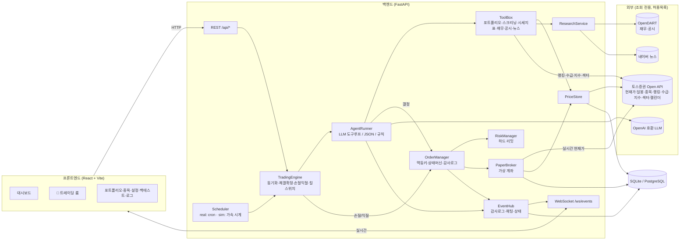
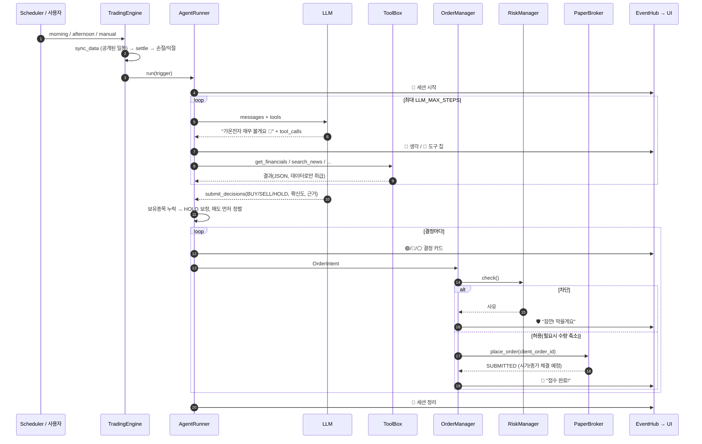
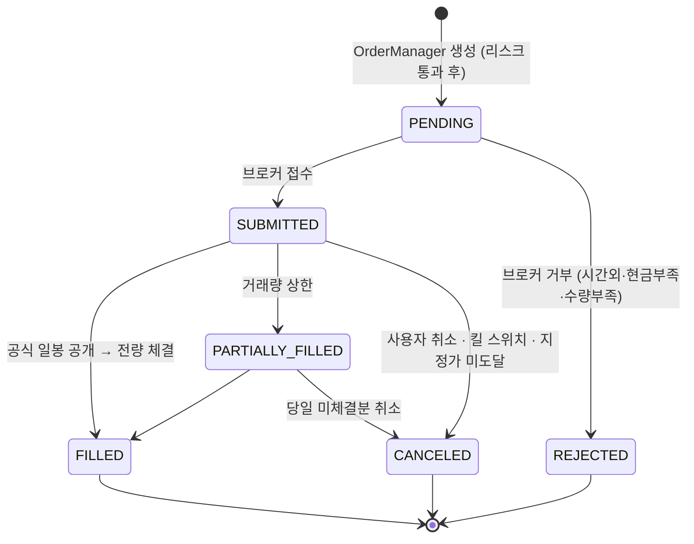

# 아키텍처

## 1. 구성도



- 모든 외부 호출은 `SafeHttpClient`(허용목록·토큰버킷·지수 백오프)를 거칩니다. 주문·계좌 경로는 토스 포함 모든 호스트에서 무조건 차단되고, 토스는 조회 7개 경로만 열려 있습니다.
- 목업 데이터는 없습니다. 테스트는 `backend/tests/fake_toss.py`(테스트 전용 가짜 토스 클라이언트)로 네트워크 없이 돕니다.

## 2. 디렉터리

```
backend/app/
  core/        설정(TRADING_MODE=paper 강제, 토스 키 필수), 마스킹 로깅, 시계(KST), 장 캘린더, 호가단위, 외부호출 허용목록
  market/      일봉 저장소, 토스증권 조회 전용 클라이언트·시세 공급자(스크리너·실시간 현재가)
  research/    OpenDART, 네이버 뉴스, ResearchService 퍼사드
  agent/       LLM 클라이언트, 도구, 프롬프트, 세션 실행기, 규칙 기반 대체 에이전트
  brokers/     BrokerInterface, PaperBroker
  risk/        RiskConfig / RiskManager
  strategies/  지표, 규칙 전략(MA 크로스, RSI)
  engine/      이벤트 허브, 주문 상태머신, 주문 관리자, 엔진, 스케줄러
  backtest/    백테스터
  reports/     일일 리포트
  api/         REST·WS 라우터, 인증
  db/          모델(UTCDateTime), 세션, Alembic 마이그레이션
frontend/src/
  components/chat/  트레이딩 룸 (말풍선·도구칩·결정카드·입력중)
  pages/            대시보드·트레이딩룸·포트폴리오·종목·설정·백테스트·로그·로그인
```

## 3. 에이전트 세션 흐름



도구 호출을 지원하지 않는 LLM 이면 자료를 미리 모아 한 번에 전달하고 JSON 결정을 받습니다(`LLM_TOOL_MODE=auto` → json 자동 전환).
LLM 이 없으면 같은 도구로 규칙 기반 결정을 냅니다.

## 4. 주문 상태 머신



허용되지 않은 전이는 `InvalidTransitionError` 입니다(`engine/state_machine.py`). 같은 `client_order_id` 로 다시 접수하면 기존 결과를 돌려줍니다(멱등).

## 5. 하루 일정과 체결 (실제 한국 시각)

```mermaid
gantt
  dateFormat  HH:mm
  axisFormat  %H:%M
  title 거래일 (KST, 토스 장 운영 캘린더 기준)
  section 매니저 (LLM)
  장전 판단 → 09:00 현재가 체결 :08:35, 25m
  정시 판단 10시            :10:00, 15m
  정시 판단 11시            :11:00, 15m
  정시 판단 12시            :12:00, 15m
  정시 판단 13시            :13:00, 15m
  정시 판단 14시            :14:00, 15m
  정시 판단 15시            :15:00, 15m
  section 엔진 (1분 주기)
  체결·손절익절 감시         :09:00, 380m
  section 마감
  15:20 미체결 만료          :milestone, 15:20, 0m
  일일 리포트               :15:45, 10m
```

- 시장가는 토스 현재가 ± 슬리피지로 즉시, 지정가는 도달 시 체결합니다. 장전 주문은 09:00 이후 첫 현재가로 체결합니다.
- 백테스터만 '다음 일봉' 체결 규칙과 `latest_published_day` 공개 시점 규칙을 씁니다(미래 정보 차단, `tests/test_backtest.py`).

## 6. 실시간 이벤트 (WebSocket)

`/ws/events?token=…` 채널:

| channel | 내용 |
|---|---|
| `chat` | 트레이딩 룸 메시지 `{role: analyst\|risk\|broker\|system\|user, kind: text\|tool\|decision\|fill\|block\|summary}` |
| `typing` | 입력 중 표시 `{role, active, label}` |
| `audit` | 감사 로그 (신호·주문·체결·리스크 차단·킬 스위치 …) |
| `state` | 엔진 상태·자산 변경 → UI 가 쿼리를 다시 불러옴 |
